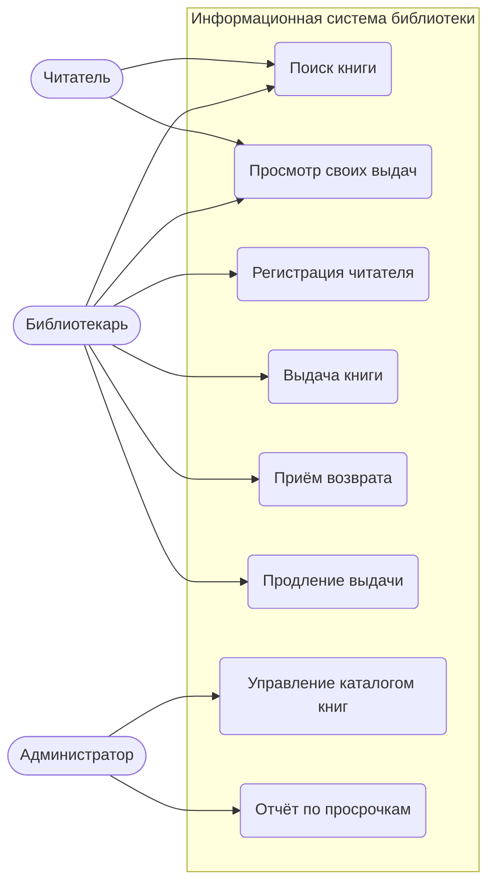
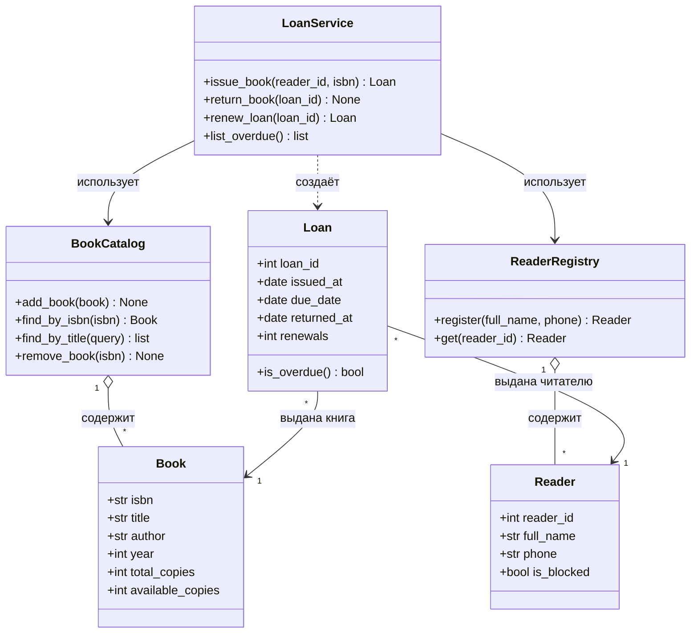
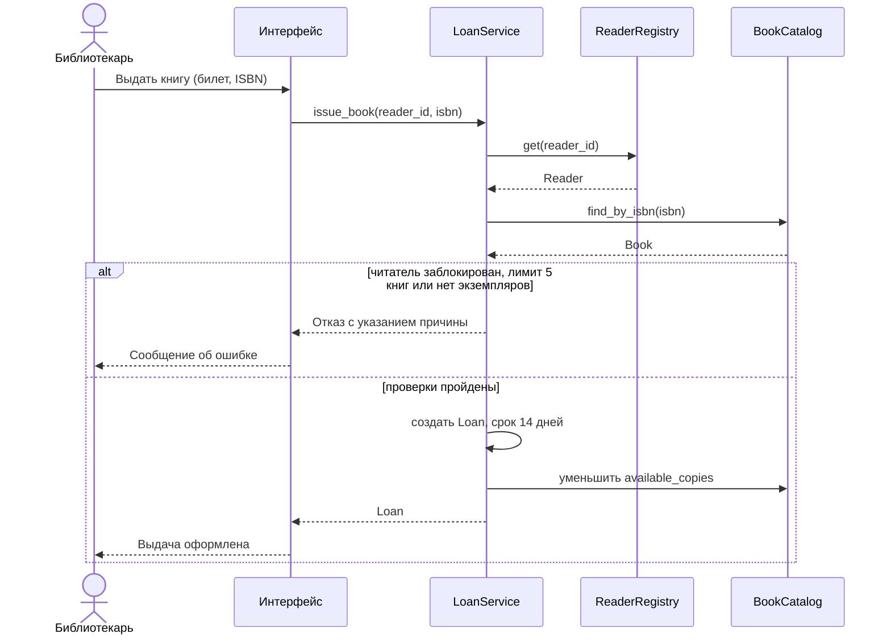
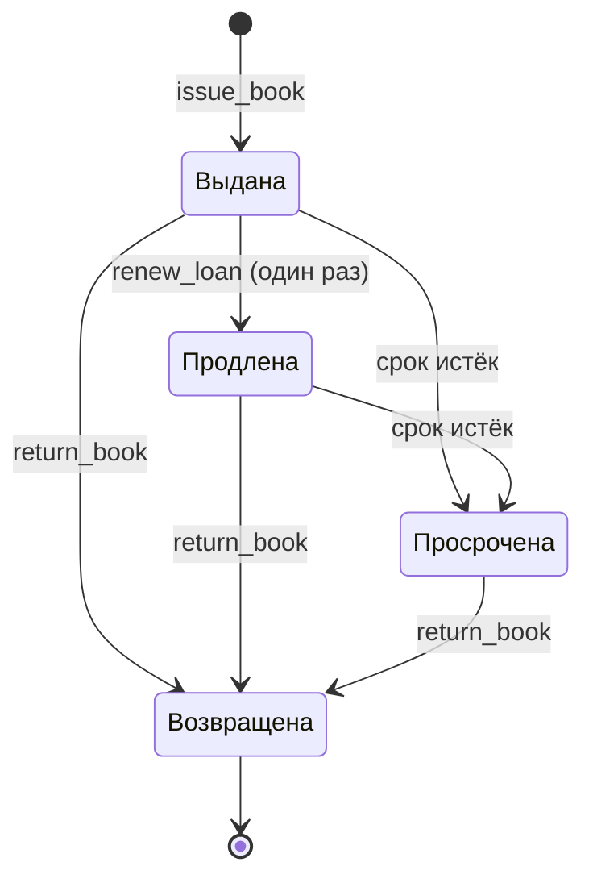

# UML-диаграммы бизнес-логики

Диаграммы написаны на Mermaid и отображаются в GitHub, GitLab, VS Code (расширение Markdown Preview Mermaid Support) и на сайте mermaid.live.

## 1. Диаграмма вариантов использования

## 2. Диаграмма классов

## 3. Диаграмма последовательности: выдача книги

## 4. Диаграмма состояний выдачи (Loan)

